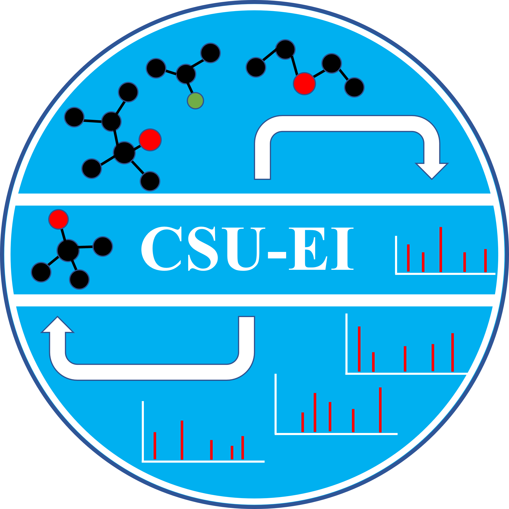

<div style="text-align: center;">
    
</div>

## CSU-EI

This is the code repo for the paper *Contrastively Spectral-structural Unification for Electron–Ionization Mass Spectrometry*. We developed a method named Contrastively Spectral-structural Unification for Electron Ionization mass spectrometry (CSU-EI)

### Package required:
We recommend using [uv](https://docs.astral.sh/uv/) to manage the Python environment and packages.

```bash
git clone https://github.com/CSU-RuixiChen/CSU-EI.git
cd CSU-EI

# Install uv (restart the shell or reload PATH if uv is not available immediately)
curl -LsSf https://astral.sh/uv/install.sh | sh

# Change this value to use a different virtual environment directory.
ENV_NAME=.venv
uv venv "$ENV_NAME" --python 3.14
source "$ENV_NAME/bin/activate"

# Create the environment and install the dependencies from pyproject.toml.
uv sync --python 3.14 --active
```

## Interacting with CSU-EI

In [`Interacting_with_CSUEI.ipynb`](Interacting_with_CSUEI.ipynb) file.

Or [`https://huggingface.co/spaces`](https://huggingface.co/spaces)

## Codebase guide

The repository is organized around model training, mass-spectrometry data processing, and retrieval evaluation:

```text
CSU-EI/
├── analyzer/
│   ├── Interacting_with_CSUEI.ipynb
│   └── core.py
├── configs/
│   └── config.json
├── data_provider/
│   └── dataset.py
├── exp/
│   ├── exp_CSUEI.py
│   └── nt_xent_loss.py
├── model/
│   ├── tokenizer-smiles-roberta/
│   │   ├── merges.txt
│   │   └── vocab.json
│   ├── CSU_EI.py
│   └── tokenizer.py
├── utils/
│   ├── NetCDF.py
│   └── tools.py
└── main.py
```

- `main.py`: Main entry point for model training.
- `analyzer/`: Retrieval evaluation, top-k analysis, and the example interaction notebook.
- `configs/config.json`: Device, dataset, model, and training configuration.
- `data_provider/dataset.py`: NIST mass-spectrometry dataset loading and preprocessing.
- `exp/exp_CSUEI.py`: Training workflow, experiment setup, evaluation, and distributed training.
- `exp/nt_xent_loss.py`: NT-Xent contrastive loss used during training.
- `model/CSU_EI.py`: CSU-EI neural network with SMILES and mass-spectrum encoders.
- `model/tokenizer.py`: SMILES tokenizer construction.
- `model/tokenizer-smiles-roberta/`: Vocabulary and merge files for the SMILES RoBERTa tokenizer.
- `utils/NetCDF.py`: NetCDF/CDF mass-spectrometry file reading utilities.
- `utils/tools.py`: Reproducibility, experiment-directory, checkpoint, and result-conversion utilities.

## Information of maintainers
- zmzhang@csu.edu.cn
- 262303055@csu.edn.cn