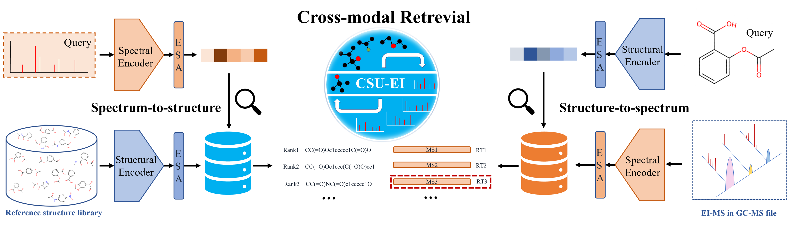

# CSU-EI
<p align="center">
  
</p>

> **Paper**: *Contrastively Spectral-structural Unification for Electron–Ionization Mass Spectrometry*

> **Authors**: Ruixi Chen, Miaomiao Li, Jia Long, Qiong Yang, Ting Xie, Shuqing Huang, Yufei Wang, Hongmei Lu, and Zhimin Zhang

---

## 1. Overview
CSU-EI is a contrastive learning framework that unifies EI-MS spectra and molecular structures for cross-modal retrieval. It overcomes traditional spectral library constraints, delivers high-accuracy compound identification, and recognizes novel compounds and similar isomers, offering a new paradigm for EI-MS analysis.

Highlights:
- 📊 **Spectral Encoder**：Transformer architecture integrated with sinusoidal m/z positional encoding for spectral feature learning.
- <span style="font-size:2em;vertical-align:-0.15em">⌬</span> **Structure Encoder**：RoBERTa‑based backbone adopts masked‑SMILES MLM pre‑training to capture intrinsic molecular structural patterns.
- 🔗 **External Space Attention**：External space attention replaces fixed pooling to effectively bridge spectrum-structure modality gaps.
- 🔍 **Bidirectional Zero‑shot Retrieval**: CLIP‑inspired contrastive learning unifies cross‑modal representations, enabling zero‑shot spectrum‑structure retrieval and GC‑MS molecular localization.
- 🌐 **Ultra-large Structural Library Support**: Equipped with a 100M molecular library and web deployment, enabling identification of library-absent compounds.

## 2. Environment Setup
We recommend using [uv](https://docs.astral.sh/uv/) to manage the Python environment and packages.

```bash
git clone https://github.com/CSU-RuixiChen/CSU-EI.git
cd CSU-EI

# Install uv (restart the shell or reload PATH if uv is not available immediately)
curl -LsSf https://astral.sh/uv/install.sh | sh

# Change this value to use a different virtual environment directory.
ENV_NAME=.venv
uv venv "$ENV_NAME" --python 3.14
source "$ENV_NAME/bin/activate"

# Create the environment and install the dependencies from pyproject.toml.
uv sync --python 3.14 --active
```

## 3. Codebase guide
The repository is organized around model training, mass-spectrometry data processing, and retrieval evaluation:

```text
CSU-EI/
├── analyzer/
│   ├── Interacting_with_CSUEI.ipynb
│   └── core.py
├── configs/
│   └── config.json
├── data_provider/
│   └── dataset.py
├── exp/
│   ├── exp_CSUEI.py
│   └── nt_xent_loss.py
├── model/
│   ├── tokenizer-smiles-roberta/
│   │   ├── merges.txt
│   │   └── vocab.json
│   ├── CSU_EI.py
│   └── tokenizer.py
├── smiles_pretrain/
│   ├── mlm_configs/
│   ├── mlm_results/
│   ├── mlm_main.py
│   └── smiles_mlm.py
├── utils/
│   ├── NetCDF.py
│   └── tools.py
└── main.py
```

- `main.py`: Main entry point for model training.
- `analyzer/`: Retrieval evaluation, top-k analysis, and the example interaction notebook.
- `configs/config.json`: Device, dataset, model, and training configuration.
- `data_provider/dataset.py`: NIST mass-spectrometry dataset loading and preprocessing.
- `exp/exp_CSUEI.py`: Training workflow, experiment setup, evaluation, and distributed training.
- `exp/nt_xent_loss.py`: NT-Xent contrastive loss used during training.
- `model/CSU_EI.py`: CSU-EI neural network with SMILES and mass-spectrum encoders.
- `model/tokenizer.py`: SMILES tokenizer construction.
- `model/tokenizer-smiles-roberta/`: Vocabulary and merge files for the SMILES RoBERTa tokenizer.
- `smiles_pretrain/`: SMILES masked-language-model pre-training code, configurations, and results.
- `smiles_pretrain/mlm_configs/`: Configuration files for SMILES masked-language-model pre-training.
- `smiles_pretrain/mlm_results/`: Checkpoints and output files generated during SMILES MLM pre-training.
- `smiles_pretrain/mlm_main.py`: Main entry point for SMILES MLM pre-training.
- `smiles_pretrain/smiles_mlm.py`: SMILES masked-language-model definition and training logic.
- `utils/NetCDF.py`: NetCDF/CDF mass-spectrometry file reading utilities.
- `utils/tools.py`: Reproducibility, experiment-directory, checkpoint, and result-conversion utilities.

## 4. CSU-EI Web Server

We provide an online **CSU-EI Web Server** that allows users to:
- 🔍 **Spectrum-to-molecule search**：Retrieve candidate molecules from a query EI mass spectrum against a **100M molecular library**, with optional filtering by mass ± tolerance or molecular formula.
- 🧮 **Cosine similarity**：Compute the similarity score between a SMILES and an EI mass spectrum via L2-normalized CSU-EI encoders.
- 📍 **Molecule localization**：Map a SMILES list onto an acquired GC-MS `.cdf` file, output as a similarity heatmap and CSV report.
- 🌐 **Online demo**：Try the web server on Hugging Face Spaces at [CSUEI\_gradio](https://huggingface.co/spaces/zzm-csu/CSUEI_gradio).
- 💾 **Database**：Download the pre-built libraries, including the **100M molecular library** (`CSUEI_100M+17mol`), from [CSUEI\_database](https://huggingface.co/datasets/zzm-csu/CSUEI_database).

## 5. Information of maintainers
- zmzhang@csu.edu.cn
- 262303055@csu.edn.cn